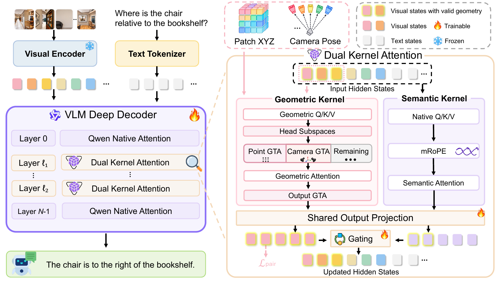
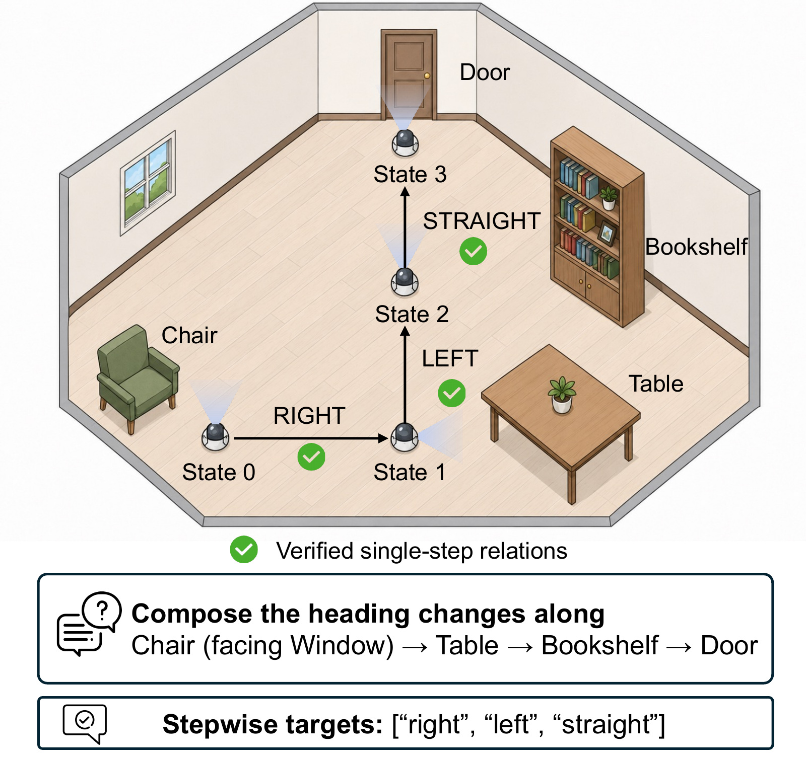

<h1 align="center">DK-VLM: Geometry as Position for Spatial Reasoning in Vision-Language Models</h1>

<p align="center">
  <a href="https://arxiv.org/pdf/2610.22356"></a>
  <a href="https://sumuru789.github.io/DK-VLM-website/"></a>
  <a href="https://huggingface.co/HITshan/DK-VLM-Model"></a>
  <a href="https://huggingface.co/datasets/HITshan/DK-VLM-RCdata"></a>
</p>

<p align="center">
  <strong>Han Su<sup>1,2</sup>, Meng Tian<sup>2</sup>, Tianyu Huang<sup>3</sup>, Mingyu Gao<sup>1</sup>, Lennox Wei<sup>1</sup>,<br>
  Dongxu Li<sup>1</sup>, Jianhua Han<sup>2</sup>, Hang Xu<sup>2</sup>, Xiaohe Wu<sup>1</sup>, Wangmeng Zuo<sup>1,*</sup></strong>
</p>

<p align="center">
  <sup>1</sup> Harbin Institute of Technology &nbsp;&nbsp;
  <sup>2</sup> Yinwang Intelligent Technology &nbsp;&nbsp;
  <sup>3</sup> Huawei
</p>

---



## Abstract

Vision-language models still struggle to understand 3D spatial relations across views and update spatial judgments as the observer moves. A common approach fuses 3D reconstruction features into visual tokens, but aligning these features with pretrained semantic representations remains challenging under limited spatial supervision. We propose **DK-VLM** with *Dual-Kernel Attention*, which computes attention from both a visual token's input position and its geometric position in the scene. A semantic kernel retains the pretrained model's native attention and positional encoding, while a separate geometric kernel uses estimated 3D points and camera poses to directly modulate attention through point displacements and relative view transformations. Then, a learned gate fuses their outputs. Geometry thus enters attention as position rather than as fused reconstruction features. We further introduce Reference-Frame Composition (RC) supervision to train the model to update its reference frame across successive judgments. It provides stepwise turn and heading targets derived from verified single-step annotations. Among the compared methods, DK-VLM-8B achieves the highest average score across six spatial benchmarks and the highest overall scores on VSI-Bench (74.33) and ReVSI-32 (58.28). RC supervision further improves multi-step spatial reasoning, while the full model preserves general video understanding.

---

## 📥 Models

Download the 7B and 8B checkpoints from [Hugging Face](https://huggingface.co/HITshan/DK-VLM-Model).

The checkpoints contain LoRA adapters and geometric branch weights. Download the matching base model separately:

| DK-VLM checkpoint | Required base model |
| --- | --- |
| `ckpt/DKVLM_Qwen25_7B` | [Qwen2.5-VL-7B-Instruct](https://huggingface.co/Qwen/Qwen2.5-VL-7B-Instruct) |
| `ckpt/DKVLM_Qwen3_8B` | [Qwen3-VL-8B-Instruct](https://huggingface.co/Qwen/Qwen3-VL-8B-Instruct) |

Use **`vggt_omega_1b_512.pt`**, available after requesting access to [VGGT-Omega](https://huggingface.co/facebook/VGGT-Omega). This is the frontend used in our experiments.

---

## 🛠️ Installation

Recommended environment: **Python 3.10.20, PyTorch 2.6.0+cu124, and CUDA 12.4**. See [environment setup](environment.md) for installation instructions.

---

## 🚀 Quick Start

Use the included [demo video](demo/README.md) and replace the model paths below:

```bash
cd inference
python demo.py \
  --checkpoint_dir ../ckpt/DKVLM_Qwen25_7B \
  --base_model_path /path/to/Qwen2.5-VL-7B-Instruct \
  --geometry_ckpt /path/to/vggt_omega_1b_512.pt \
  --video ../demo/sample.mp4 \
  --question "How many chair(s) are in this room?"
```

For 8B, switch to `../ckpt/DKVLM_Qwen3_8B` and the matching Qwen3-VL base model. `--video` also accepts your own video or a directory of image frames.

For VSI-Bench and ReVSI-32 evaluation, see [evaluation instructions](inference/README.md#evaluation).

---

## 📊 RC Annotations

Single-step spatial QA typically supervises judgments within a given reference frame, but lacks explicit supervision for updating that frame across successive turns or viewpoint changes. RC composes verified single-step relations into **1.6M examples with 2–4 reasoning steps**, providing turn or heading targets at each step.

<p align="center">
  
</p>

Download the [RC annotations](https://huggingface.co/datasets/HITshan/DK-VLM-RCdata). See the [RC documentation](data/rc/README.md) for the annotation format and source datasets. Original images/videos are not included.

---

## 📖 Citation

```bibtex
@misc{su2026dkvlmgeometrypositionspatial,
  title={DK-VLM: Geometry as Position for Spatial Reasoning in Vision-Language Models},
  author={Han Su and Meng Tian and Tianyu Huang and Mingyu Gao and Lennox Wei and Dongxu Li and Jianhua Han and Hang Xu and Xiaohe Wu and Wangmeng Zuo},
  year={2026},
  eprint={2610.22356},
  archivePrefix={arXiv},
  primaryClass={cs.CV},
  url={https://arxiv.org/abs/2610.22356},
}
```
